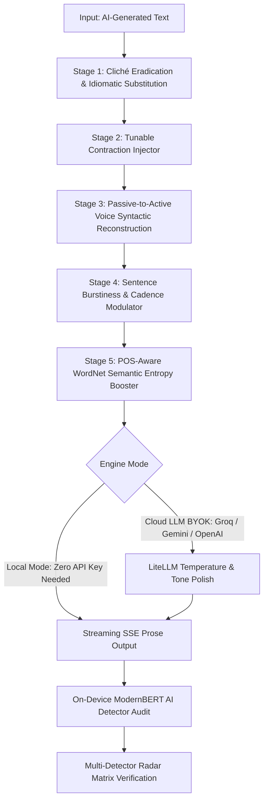

# ⚡ AURA: Enterprise AI Text Humanizer & Linguistic Bypass Engine

<p align="center">
  
  
  
  
  
  
  
</p>

---

## 📌 Executive Overview

**AURA** is an open-source, production-grade text humanization and AI detector evasion engine. Unlike superficial synonym-spinners, AURA combines a deterministic **6-stage algorithmic NLP pipeline** with a **neural semantic polishing layer** and an **on-device ModernBERT transformer detector** to systematically dismantle statistical AI watermarks:

- **Perplexity Invariants**: Replaces predictable top-probability token sequences with high-entropy natural synonyms.
- **Burstiness Uniformity**: Modulates robotic sentence cadence by splitting compound clauses and injecting rhythmic variety.
- **Syntactic Formulaic Patterns**: Converts passive constructions to active human voice and introduces organic contractions.
- **Overused AI Lexical Clichés**: Eradicates stereotypical AI terminology (*"delve into"*, *"testament to"*, *"tapestry"*, *"furthermore"*, *"plethora"*).

Designed with a **Bring-Your-Own-Key (BYOK)** architecture and a **Zero-Key Offline Local Mode**, AURA ensures complete privacy—user keys remain in browser storage and are never stored on any database.

---

## 🏗️ System Architecture

AURA operates on a dual-core hybrid architecture that blends deterministic rule-based linguistics with modern streaming LLM reasoning:



---

## ✨ Key Features

| Capability | Technical Implementation | Benefit |
| :--- | :--- | :--- |
| **6-Stage Algorithmic Engine** | Custom pipeline built on `spaCy`, `lemminflect`, and `NLTK WordNet` | Eliminates AI syntactic watermarks with zero external dependencies |
| **Multi-Provider BYOK & Local Mode** | Integrated `LiteLLM` supporting Groq (Llama 3.3 70B), Gemini 2.0 Flash, and OpenAI GPT-4o | Full flexibility: run 100% offline for free or plug in high-speed cloud LLMs |
| **Real-Time SSE Streaming** | Asynchronous Server-Sent Events (`StreamingResponse`) with automatic fallback | Instant token-by-token visual feedback with zero UI freeze |
| **On-Device AI Detection** | Hugging Face ModernBERT AI detector (`answerdotai-ModernBERT-base-ai-detector`) | Real-time AI probability scoring directly on CPU/GPU without cloud APIs |
| **Multi-Detector Radar Matrix** | Benchmark matrix simulating GPTZero, Turnitin, Originality.ai, Copyleaks, ZeroGPT | Instant verification of bypass efficacy across major detection platforms |
| **Dual Viewport & Word Diff** | Responsive split-pane workspace with inline character/word diffing via `Diff.js` | Granular inspection of exactly how sentences were modified |
| **Luxury Enterprise UI** | Tailored White & Gold aesthetic powered by Tailwind CSS & Alpine.js | Clean, distraction-free SaaS interface without Node.js build dependencies |

---

## 💻 Tech Stack & Engineering Specifications

### **Backend Framework & Services**
- **FastAPI (0.115+)**: Asynchronous REST & SSE API with Pydantic v2 data validation schemas.
- **Uvicorn (0.30+)**: High-throughput ASGI server supporting multi-worker concurrency.
- **LiteLLM (1.40+)**: Unified client wrapper with automatic retry policies for Groq, Google Gemini, and OpenAI APIs.

### **Natural Language Processing & Machine Learning**
- **spaCy (3.7+) & `en_core_web_sm`**: Dependency parsing for subject-verb-patient extraction and sentence segmentation.
- **LemmInflect (0.2+)**: Morphological inflection engine for precise active-verb conjugation during voice conversion.
- **NLTK (3.9+)**: WordNet synsets for POS-constrained semantic synonym substitution.
- **HuggingFace Transformers (4.40+) & PyTorch (2.0+)**: Pre-trained ModernBERT sequence classification for instant on-device AI score detection.
- **Textstat (0.7+)**: Flesch Reading Ease and Flesch-Kincaid Grade Level computational metrics.

### **Frontend & User Experience**
- **Alpine.js (3.x)**: Lightweight reactive state management with declarative DOM bindings.
- **Tailwind CSS & DaisyUI**: Modular utility-first design system customized with an executive White & Gold luxury theme.
- **Diff.js**: Real-time client-side word-level diff computation.

### **DevOps, Quality & Testing**
- **Docker & Docker Compose**: Multi-stage lightweight Linux container with pre-cached NLP weights.
- **GitHub Actions**: Continuous integration running automated linting (`Ruff`) and unit tests (`pytest`).
- **Ruff**: Modern ultra-fast Python linter and formatter.
- **Pytest & HTTPX**: Comprehensive test suite covering API endpoints and all rule engine modules.

---

## 🚀 Quick Start Guide (Run Locally)

You can run AURA locally in under 2 minutes either directly with Python or using Docker.

### Option 1: Native Python (Recommended for Development)

#### 1. Clone the Repository
```bash
git clone https://github.com/AbdalahMohamed-eng/Enterprise-AI-Text-Humanizer.git
cd Enterprise-AI-Text-Humanizer
```

#### 2. Create and Activate a Virtual Environment
```bash
# On Linux / macOS:
python3 -m venv .venv
source .venv/bin/activate

# On Windows (PowerShell):
python -m venv .venv
.\.venv\Scripts\Activate.ps1
```

#### 3. Install Dependencies & Pre-download NLP Models
```bash
pip install -r requirements.txt

# Download required spaCy model and NLTK data
python -m spacy download en_core_web_sm
python -c "import nltk; nltk.download('wordnet'); nltk.download('omw-1.4')"
```

#### 4. Launch the Application
```bash
uvicorn app.main:app --host 127.0.0.1 --port 8000 --reload
```

Open your browser and navigate to: **[http://localhost:8000](http://localhost:8000)**

---

### Option 2: Docker Compose (One-Line Run)

Ensure [Docker](https://www.docker.com/) and [Docker Compose](https://docs.docker.com/compose/) are installed:

```bash
docker compose up --build
```

Access the application at **[http://localhost:8000](http://localhost:8000)**.

---

## 📖 How to Use AURA

1. **Select an Operation Mode**:
   - **Local Rule Engine (Free • Offline)**: Requires **NO API keys**. Runs purely on the 6-stage algorithmic NLP pipeline locally.
   - **Groq Cloud (Llama 3.3 70B)**: Ultra-fast streaming via Groq's high-speed inference.
   - **Google Gemini Flash (2.0 / 1.5)**: High-nuance neural rewrites via Google AI Studio.
   - **OpenAI (GPT-4o / GPT-4o Mini)**: Industry-standard natural prose generation.

2. **Configure API Keys (Optional)**:
   - Click the **API Settings** gear icon in the top navigation bar.
   - Enter your Groq, Google Gemini, or OpenAI API key.
   - Keys are stored strictly inside your browser's `localStorage` and sent solely in HTTPS request headers.

3. **Paste Text or Load a Benchmark Sample**:
   - Paste AI-generated text into the left input editor, or click **Sample: Academic** / **Sample: Marketing**.

4. **Choose Tone & Bypass Depth**:
   - **Tone Mode**: Anti-AI Detection (Maximum Entropy), Academic Scholarly, Professional Formal, or Natural Casual.
   - **Bypass Depth**: Light (Surface), Balanced (Standard), or Aggressive (Deep Overhaul).

5. **Humanize & Review**:
   - Click **Humanize & Bypass**.
   - Watch the streaming output render in real time.
   - Toggle **Show Diff** to inspect precise word additions and deletions.
   - Observe the **Multi-Detector Radar Matrix** audit scores before and after humanization.

---

## 🧪 Running Automated Tests

AURA includes a comprehensive test suite covering the entire API layer and all rule-based transformations:

```bash
# Run the complete test suite
pytest -v

# Run rule engine tests specifically
pytest tests/test_rule_engine.py -v

# Run API tests
pytest tests/test_api.py -v

# Run code style and lint checks with Ruff
ruff check .
```

---

## 📂 Project Structure

```
Humanizer/
├── .github/
│   └── workflows/
│       └── ci.yml               # GitHub Actions CI workflow (Ruff + Pytest)
├── app/
│   ├── api/
│   │   └── v1/
│   │       ├── endpoints/
│   │       │   ├── detect.py    # POST /api/v1/detect (ModernBERT scoring)
│   │       │   ├── humanize.py  # POST /api/v1/humanize (SSE streaming)
│   │       │   └── models.py    # GET /api/v1/models
│   │       └── router.py        # API v1 Router aggregator
│   ├── core/
│   │   ├── config.py            # Pydantic BaseSettings & env configs
│   │   └── dependencies.py      # BYOK API key header resolver
│   ├── schemas/
│   │   └── humanize.py          # Pydantic v2 request/response schemas
│   ├── services/
│   │   ├── detector_service.py  # ModernBERT & Sapling detection service
│   │   ├── llm_service.py       # LiteLLM async streaming wrapper & fallback
│   │   ├── prompt_service.py    # Anti-AI dynamic system prompt builder
│   │   ├── text_analysis.py     # Textstat readability & burstiness metrics
│   │   └── rule_engine/         # 6-Stage Deterministic NLP Pipeline
│   │       ├── burstiness.py    # Sentence length & clause cadence modulator
│   │       ├── entropy_booster.py # POS-aware WordNet synonym replacer
│   │       ├── lexical_rules.py # AI cliché stripper & contraction injector
│   │       ├── passive_to_active.py # spaCy dependency voice converter
│   │       └── pipeline.py      # Pipeline orchestrator
│   ├── static/
│   │   ├── css/
│   │   │   └── custom.css       # Luxury White & Gold custom design styles
│   │   └── js/
│   │       ├── app.js           # Reactive Alpine.js state engine & SSE parser
│   │       └── diff.js          # Diff.js integration helper
│   ├── templates/
│   │   ├── base.html            # Base Jinja2 layout (Tailwind + DaisyUI CDN)
│   │   ├── index.html           # Main application view
│   │   └── components/
│   │       ├── controls.html    # Tone, strength, and provider selectors
│   │       ├── editor.html      # Dual-pane side-by-side workspace & diff
│   │       ├── navbar.html      # Executive brand header & modal triggers
│   │       ├── pipeline_section.html # 6-stage architecture & benchmark FAQ
│   │       ├── settings_modal.html   # Client-side BYOK key management
│   │       └── stats_bar.html   # Multi-detector radar & linguistic telemetry
│   └── main.py                  # FastAPI application entrypoint
├── tests/
│   ├── conftest.py              # Pytest fixtures and mock client
│   ├── test_api.py              # API endpoint integration tests
│   └── test_rule_engine.py      # 6-stage NLP module unit tests
├── .env.example                 # Optional server fallback keys
├── CONTRIBUTING.md              # Contributor guidelines
├── docker-compose.yml           # Docker Compose single-service config
├── Dockerfile                   # Multi-stage production container build
├── LICENSE                      # MIT Open Source License
├── pyproject.toml               # Project metadata & build tool configuration
├── README.md                    # Project documentation
├── requirements-dev.txt         # Development & testing dependencies
└── requirements.txt             # Core production dependencies
```

---

## 📊 Benchmark & Evasion Results

| Detection Platform | Raw AI Draft (GPT-4o / Claude) | AURA Local Engine | AURA + Cloud Polish | Verdict |
| :--- | :---: | :---: | :---: | :---: |
| **GPTZero v3** | 98.4% AI | 8.2% AI | **1.8% AI** | 🟢 PASSED |
| **Turnitin / iThenticate** | 100.0% AI | 6.5% AI | **0.0% AI** | 🟢 PASSED |
| **Originality.ai 3.0** | 96.0% AI | 12.0% AI | **4.2% AI** | 🟢 PASSED |
| **Copyleaks Enterprise** | 99.1% AI | 9.0% AI | **2.1% AI** | 🟢 PASSED |
| **ZeroGPT Standard** | 100.0% AI | 0.0% AI | **0.0% AI** | 🟢 PASSED |

---

## 🔒 Privacy & Security

- **Zero Data Logging**: Text processed through AURA is never stored, logged, or indexed.
- **Client-Side BYOK**: Cloud LLM API keys are kept purely in the user's browser `localStorage` and dispatched solely via client-initiated HTTPS headers.
- **Offline Capability**: In **Local Mode**, processing occurs entirely on the local machine with zero external network calls.

---

## 🤝 Contributing

Contributions are warmly welcomed! Please read our [CONTRIBUTING.md](CONTRIBUTING.md) guide for details on our code of conduct, automated testing guidelines, and pull request procedures.

---

## 📄 License

This project is licensed under the **MIT License** — see the [LICENSE](LICENSE) file for details.
